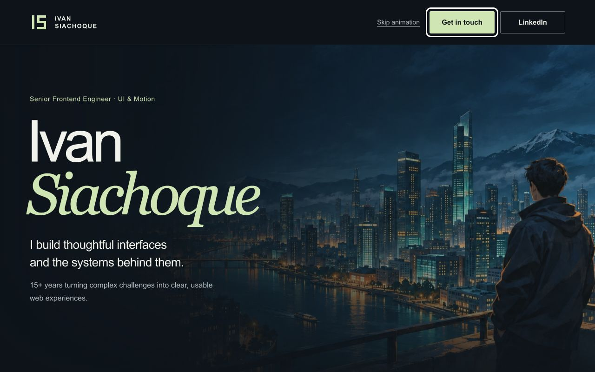
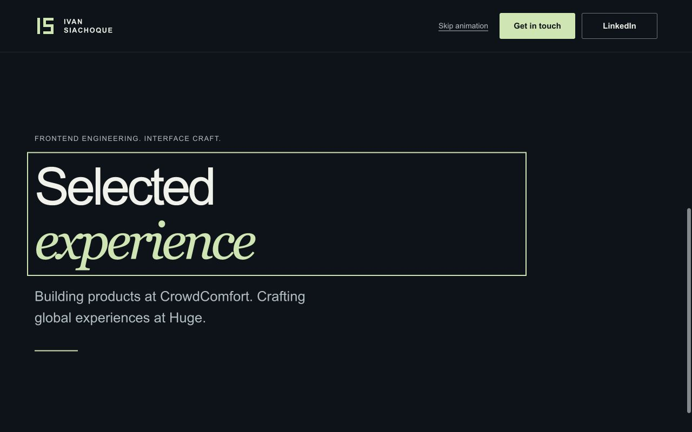

## Summary

The static portfolio introduction now becomes a reversible, scroll-linked journey
into Selected experience. City and foreground figure move independently, the
professional copy exits before the name, and a dark fade introduces the next
editorial panel. Recruiters can contact Ivan at any point or skip directly to
the panel with destination focus.

- Add the approved layered artwork and GSAP/ScrollTrigger progression.
- Keep contact controls outside fading content and native scrolling intact.
- Show both sections in static reading order for reduced motion and layouts
  where the content cannot fit.
- Rebuild or clean up on viewport and preference changes, preserving focus and
  preventing duplicate pin spacers.
- Retain the original flattened illustration and document the generative edits.

## Validation

- `npm run build` passes, including TypeScript.
- Browser checks covered start/middle/end, reverse traversal, pointer and
  keyboard skip, persistent contact, 320px/390px mobile, short landscape,
  enlarged text, image failure, lifecycle cleanup, and the served production build.
- Public matchMedia results and change events were simulated with a temporary
  local QA harness because the in-app browser has no media-emulation control.
  The harness was removed and its absence checked in the production output.
- Normal copy/contact samples exceed 4.5:1; measured minimum 6.36:1. Final bridge
  colors on solid ink range from 10.70:1 to 17.03:1.
- Standards review: zero findings. Spec review: one P2 focus-handling finding,
  corrected and reviewed again; no unresolved findings.
- Verification used one browser environment, not a cross-browser matrix or full
  screen reader session. Text enlargement used a 200% root font size rather than
  browser page zoom; OS motion preferences were not changed.

## Ticket and review

- [Ticket 01: Build the cinematic Opening transition](https://github.com/ivansiach0/ivansiacho/blob/9532b05/.scratch/opening-transition/issues/01-build-cinematic-opening-transition.md)
- [Approved specification](https://github.com/ivansiach0/ivansiacho/blob/9532b05/.scratch/opening-transition/spec.md)
- [Validation and limitations](https://github.com/ivansiach0/ivansiacho/blob/9532b05/.scratch/opening-transition/validation.md)
- [Standards and Spec review](https://github.com/ivansiach0/ivansiacho/blob/9532b05/.scratch/opening-transition/review.md)

## Preview

## Scope

This ticket ends at the short Experience bridge. Detailed professional chapters,
case studies, CV download, and site deployment remain separate features.
